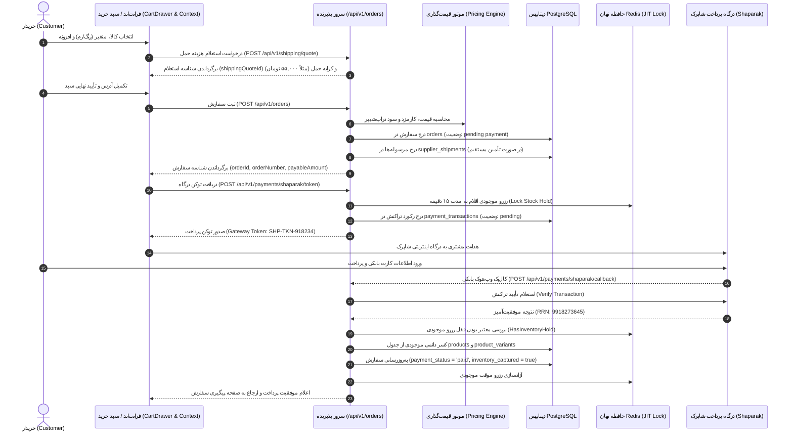
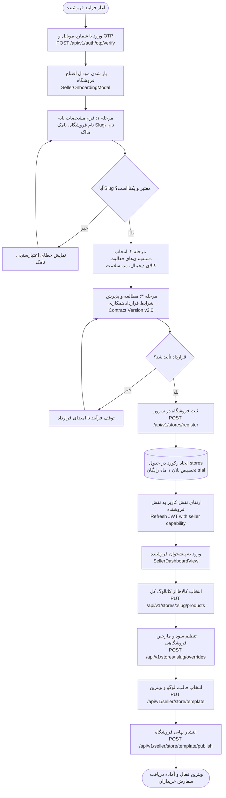
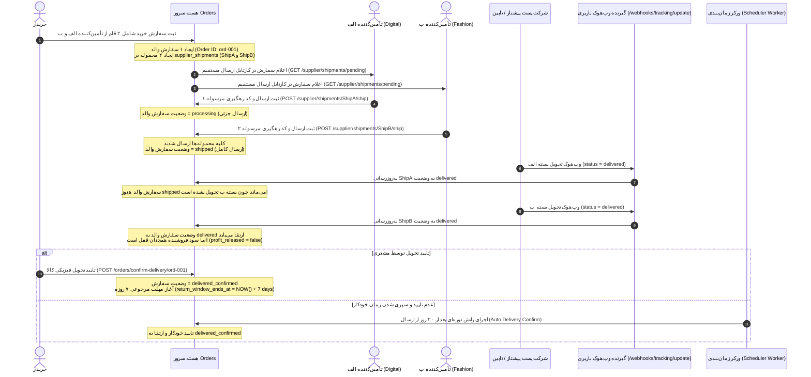
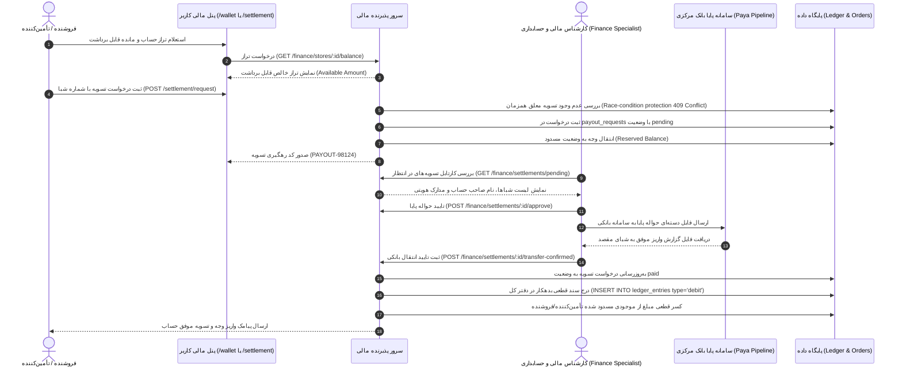
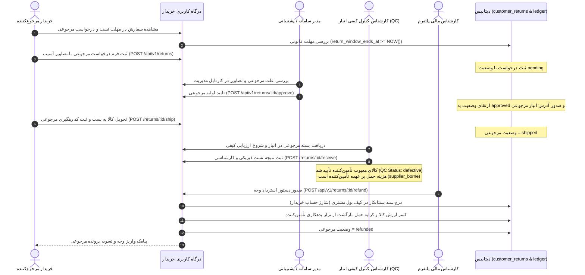

# گزارش جامع نقشه‌برداری جریان‌های کاری، چرخه‌های حیات و گذار وضعیت‌ها در پلتفرم Sellersho

**تهیه‌کننده:** تیم کاوشگر معماری و تحلیل جریان‌های کاری (Explorer Survey 3 Gen2)  
**تاریخ نگارش:** نوامبر ۲۰۲۶ / آبان ۱۴۰۵  
**مخاطب:** تیم فنی، مستندسازی و توسعه پلتفرم Sellersho  
**موقعیت گزارش:** `survey_workflow_report.md`

---

## فهرست مطالب

1. [مقدمه و معماری کلان جریان‌های کاری (High-Level Architecture)](#۱-مقدمه-و-معماری-کلان-جریانهای-کاری)
2. [جریان کاری ۱: خرید مشتری و تسویه‌حساب (Customer Purchase & Checkout Workflow)](#۲-جریان-کاری-۱-خرید-مشتری-و-تسویهحساب)
   - ۲.۱. مرور فرآیند از مرور کالا تا ثبت و پرداخت
   - ۲.۲. نمودار توالی سناریوی خرید و رزرو موجودی JIT (Mermaid Sequence)
   - ۲.۳. جزئیات گام‌به‌گام و نمونه داده واقعی (Concrete Example)
3. [جریان کاری ۲: ثبت‌نام، راه‌اندازی و قیمت‌گذاری فروشنده (Seller Onboarding & Listing Workflow)](#۳-جریان-کاری-۲-ثبتنام-راهاندازی-و-قیمتگذاری-فروشنده)
   - ۳.۱. مراحل آنبوردینگ دراپ‌شیپر و احراز هویت
   - ۳.۲. نمودار جریان فرآیند راه‌اندازی و انتشار فروشگاه (Mermaid Flowchart)
   - ۳.۳. تنظیمات مارجین، ویجت‌های فروش و شخصی‌سازی قالب
4. [جریان کاری ۳: پردازش و ارسال سفارشات دراپ‌شیپینگ (Dropshipping Order Fulfillment & Multi-Supplier Split)](#۴-جریان-کاری-۳-پردازش-و-ارسال-سفارشات-دراپشیپینگ)
   - ۴.۱. مدل تفکیک سفارشات چندتأمین‌کننده‌ای (Multi-Supplier Order Split)
   - ۴.۲. مدل دوگانه تأمین: انبار مرکزی (Warehouse) در برابر ارسال مستقیم (Supplier Direct)
   - ۴.۳. نمودار توالی تفکیک چندتأمین‌کننده و لجستیک (Mermaid Sequence)
   - ۴.۴. ماشین وضعیت سفارش و بسته‌ها (State Transition Matrix)
5. [جریان کاری ۴: تراکنش‌های مالی، تسهیم درآمد و تسویه بانکی (Financial Settlement & Accounting)](#۵-جریان-کاری-۴-تراکنشهای-مالی-تسهیم-درآمد-و-تسویه-بانکی)
   - ۵.۱. فرمول تسهیم سود و حسابداری دوبل (Double-Entry Ledger)
   - ۵.۲. تسویه دوره‌ای ماهانه و برداشت زودهنگام (Monthly Sweep vs Early Withdrawal)
   - ۵.۳. فرمول مانده‌حساب تأمین‌کننده (Supplier Balance Equation)
   - ۵.۴. نمودار جریان چرخه تسویه پایا (Mermaid Sequence)
6. [جریان کاری ۵: مرجوعی، گارانتی و حل اختلاف (Return, Warranty & Dispute Lifecycle)](#۶-جریان-کاری-۵-مرجوعی-گارانتی-و-حل-اختلاف)
   - ۶.۱. چرخه مرجوعی کالا در مهلت قانونی (۷ روزه)
   - ۶.۲. تخصیص هزینه حمل مرجوعی (Return Shipping Cost Bearer)
   - ۶.۳. چرخه تایید گارانتی و داوری اختلافات تحویل (Dispute Resolution)
   - ۶.۴. نمودار توالی مرجوعی و بازرسی کیفی انبار (Mermaid Sequence)
7. [ماتریس جامع رخدادها، جداول پایگاه داده و نقاط انتهایی API](#۷-ماتریس-جامع-رخدادها-جداول-پایگاه-داده-و-نقاط-انتهایی-api)

---

## ۱. مقدمه و معماری کلان جریان‌های کاری

پلتفرم **Sellersho (با نام تجاری پیشین Drup)** یک سامانه جامع تجارت الکترونیک دراپ‌شیپینگ (Dropshipping E-Commerce Ecosystem) است که چهار بازیگر اصلی را در قالب یک هسته ماژولار هماهنگ می‌کند:
1. **خریدار نهایی (Storefront Customer):** جستجو در ویترین‌های مستقل دراپ‌شیپری یا ویترین مرکزی، خرید چندکالایی، پرداخت آنلاین شاپرک، و رهگیری مرسولات.
2. **فروشنده مستقل / دراپ‌شیپر (Dropshipper / Store Owner):** راه‌اندازی فروشگاه با نام و دامنه اختصاصی، انتخاب کالا از کاتالوگ تأمین‌کنندگان، تعیین سود دلخواه (Markup)، ایجاد کدهای تخفیف و ابزارهای فروش، و دریافت پورسانت خالص.
3. **تأمین‌کننده کالا (Supplier / Vendor):** ثبت و مدیریت کاتالوگ کالا، قیمت‌گذاری عمده (Wholesale Base Cost)، ارسال مستقیم (Direct Shipping) با حفظ حریم خصوصی یا ارسال بار عمده به انبار مرکزی (Inbound ASN).
4. **اپراتورهای پلتفرم (Platform Operators):** شامل مدیر کل (Admin)، پرسنل انبارداری و کنترل کیفیت (Warehouse Staff / QC)، کارشناسان مالی و حسابداری (Finance Specialist)، و کارشناسان پشتیبانی و داوری (Support / Dispute Arbiter).

معماری سیستم از یک **Go Modular Monolith** با لایه‌بندی شفاف دامنه (Domain Repository Pattern)، پایگاه‌داده توزیع‌شده رابطه ای PostgreSQL، حافظه نهان Redis جهت رزرو موجودی Just-In-Time (JIT) و کشینگ توکن‌های تبلیغاتی و کاتالوگ، و یک رابط کاربری واکنش‌گرا مبتنی بر React و Tailwind CSS تشکیل شده است.

---

## ۲. جریان کاری ۱: خرید مشتری و تسویه‌حساب (Customer Purchase & Checkout Workflow)

### ۲.۱. مرور فرآیند
جریان خرید از ویترین فروشگاه آغاز شده و تا ثبت قطعی تراکنش در درگاه پرداخت شاپرک ادامه می‌یابد:
1. **مرور کاتالوگ و صفحه محصول (Storefront & PDP):** مشتری وارد فروشگاه می‌شود (`GET /api/v1/stores/:slug`). کالاها از طریق `GET /api/v1/products?storeId=:slug` لود می‌شوند. قیمت نهایی کالا توسط موتور قیمت‌گذاری شناور (`pricing.ResolveReferencePricing`) محاسبه می‌شود که شامل قیمت پایه تأمین‌کننده، کارمزد پلتفرم، و حاشیه سود اختصاصی فروشنده است.
2. **انتخاب متغیرها و افزونه‌ها (Variants & Addons):** مشتری رنگ/سایز مورد نظر (`variantId`) و افزونه‌های مجاز (`addonIds` نظیر بسته‌بندی هدیه یا گارانتی طلایی) را انتخاب کرده و دکمه افزودن به سبد را می‌زند.
3. **مدیریت سبد خرید بر اساس فروشگاه (Per-Store Cart Isolation):** در لایه فرانت‌اند (`CartContext.tsx`) سبدهای خرید بر اساس `storeId` تفکیک شده و در `localStorage` تحت کلید `drup_carts` نگهداری می‌شوند. هر فروشگاه سبد مجزای خود را دارد تا از تداخل مالیاتی و حاشیه سود جلوگیری شود.
4. **انتخاب آدرس و استعلام هزینه حمل (Shipping Quote):** با وارد کردن استان و شهر مقصد، سیستم از طریق `POST /api/v1/shipping/quote` بر اساس وزن مرسوله، مبدأ ارسال (انبار مرکزی یا انبار تأمین‌کننده)، و تعرفه لجستیک (پست پیشتاز یا تاپین)، هزینه دقیق ارسال را صادر و یک `shippingQuoteId` یکتا با اعتبار موقت تولید می‌کند.
5. **ثبت اولیه سفارش (Order Creation):** ارسال درخواست `POST /api/v1/orders`. پلتفرم سفارش را در وضعیت `status = 'processing'` و `payment_status = 'pending'` ثبت می‌کند. در صورتی که کالاها متعلق به تأمین‌کنندگان مستقیم باشند، برای هر تأمین‌کننده یک رکورد بارنامه مستقل در جدول `supplier_shipments` با شناسه یکتا ایجاد می‌شود.
6. **رزرو موقت موجودی در ردیس (JIT Inventory Reservation):** با فراخوانی `POST /api/v1/payments/shaparak/token`، سیستم موجودی تک‌تک اقلام سفارش را در Redis با انقضای ۱۵ دقیقه قفل (`SETNX / EXPIRE`) می‌کند تا از Over-selling جلوگیری شود و توکن درگاه (`SHP-TKN-xxxxxx`) صادر می‌گردد.
7. **بازگشت از درگاه و تایید قطعی (Callback & Payment Capture):** پس از پرداخت، درگاه شاپرک متد `POST /api/v1/payments/shaparak/callback` را فراخوانی می‌کند. سیستم با استعلام از سرور شاپرک تراکنش را وریفای کرده، موجودی را به طور دائم در دیتابیس کسر (`UPDATE products SET stock = stock - quantity`)، قفل ردیس را آزاد، و وضعیت سفارش را به `payment_status = 'paid'` و `inventory_captured = TRUE` ارتقا می‌دهد.

---

### ۲.۲. نمودار توالی سناریوی خرید و رزرو موجودی JIT (Mermaid Sequence)



---

### ۲.۳. جزئیات گام‌به‌گام و نمونه داده واقعی (Concrete Example)

#### سناریوی فرضی:
مشتری به نام **«امیرحسین کاظمی»** از فروشگاه **«فروشگاه دیجیتال آریا» (slug: arya-shop)** یک عدد گوشی هوشمند با هزینه عمده ۱۰,۰۰۰,۰۰۰ تومان و مارجین فروشنده ۱۵٪ به همراه گارانتی طلایی (افزونه ۱۰۰,۰۰۰ تومانی) خریداری می‌کند.

1. **ارسال استعلام کرایه حمل (`POST /api/v1/shipping/quote`):**
```json
{
  "province": "تهران",
  "city": "تهران",
  "address": "خیابان ولیعصر، برج سپهر، طبقه ۴",
  "postalCode": "1987654321",
  "lines": [
    {
      "productId": "prod-phone-x1",
      "variantId": "var-256gb-black",
      "quantity": 1
    }
  ]
}
```
*پاسخ دریافتی:*
```json
{
  "quoteId": "QUO-99182-TK",
  "totalShipping": 65000,
  "legs": [
    {
      "legIndex": 0,
      "origin": "انبار مرکزی تهران",
      "carrier": "پست پیشتاز",
      "fare": 65000
    }
  ]
}
```

2. **ایجاد سفارش (`POST /api/v1/orders`):**
```json
{
  "storeId": "arya-shop",
  "customerInfo": {
    "fullName": "امیرحسین کاظمی",
    "province": "تهران",
    "city": "تهران",
    "address": "خیابان ولیعصر، برج سپهر، طبقه ۴",
    "postalCode": "1987654321"
  },
  "paymentMethod": "cash",
  "shippingQuoteId": "QUO-99182-TK",
  "items": [
    {
      "productId": "prod-phone-x1",
      "variantId": "var-256gb-black",
      "quantity": 1,
      "addonIds": ["addon-warranty-gold"]
    }
  ]
}
```
*محاسبات مالی درون‌برنامه‌ای:*
- هزینه پایه عمده (Wholesale Cost): ۱۰,۰۰۰,۰۰۰ تومان
- کارمزد پلتفرم (Platform Fee 2.5%): ۲۵۰,۰۰۰ تومان
- سود دراپ‌شیپر (Dropshipper Margin 15%): ۱,۵۰۰,۰۰۰ تومان
- افزونه گارانتی: ۱۰۰,۰۰۰ تومان
- هزینه حمل: ۶۵,۰۰۰ تومان
- **مبلغ کل قابل پرداخت (Payable Amount): ۱۱,۹۱۵,۰۰۰ تومان**

3. **دریافت توکن درگاه شاپرک (`POST /api/v1/payments/shaparak/token`):**
```json
{
  "orderId": "ord-887192a-3341",
  "orderNumber": "ORD-B4C819",
  "amount": 11915000,
  "redirectUrl": "https://sellersho.ir/payment-result"
}
```
*خروجی:*
```json
{
  "token": "SHP-TKN-581923",
  "orderNumber": "ORD-B4C819",
  "amount": 11915000,
  "message": "توکن پرداخت اینترنتی شاپرک صادر شد"
}
```

---

## ۳. جریان کاری ۲: ثبت‌نام، راه‌اندازی و قیمت‌گذاری فروشنده (Seller Onboarding & Listing Workflow)

### ۳.۱. مراحل آنبوردینگ دراپ‌شیپر
1. **احراز هویت بدون پسورد (OTP Authentication):**
   - کاربر شماره همراه خود (`0919xxxxxxx`) را در مسیر `POST /api/v1/auth/otp/send` وارد می‌کند.
   - کد پیامک شده در `POST /api/v1/auth/otp/verify` تایید شده و توکن JWT با نقش پایه صادر می‌گردد.
2. **ثبت نام و ایجاد فروشگاه (Store Registration - ۴ مرحله‌ای):**
   - **گام ۱ (اطلاعات فروشگاه):** نام فروشگاه، نامک اختصاصی انگلیسی (`slug`)، نام مدیر، و کد معرف (Referral Code).
   - **گام ۲ (دسته‌بندی‌ها و هدف‌گذاری):** انتخاب حوزه‌های کاری (مانند کالای دیجیتال، پوشاک، زیبایی).
   - **گام ۳ (شرایط همکاری و قرارداد):** تایید صریح نسخه قرارداد هوشمند (`signedContractVersion = 2`).
   - فراخوانی `POST /api/v1/stores/register`، تخصیص شناسه فروشگاه (`store-xxxxx`) و فعال‌سازی قابلیت `seller` روی توکن کاربر.
3. **انتخاب قالب و طراحی ویترین (Template Customization):**
   - انتخاب قالب از بین قالب‌های پیش‌فرض پلتفرم از طریق `GET /api/v1/store-templates`.
   - ذخیره تنظیمات ظاهری، بنرها و چیدمان با `PUT /api/v1/seller/store/template` و انتشار نهایی با `POST /api/v1/seller/store/template/publish`.
4. **واردسازی کالاهای تأمین‌کنندگان (Product Catalog Import):**
   - مرور کاتالوگ عمومی تأمین‌کنندگان تأییدشده.
   - درج کالاها در سبد فروشگاهی با `PUT /api/v1/stores/:slug/products` با بدنه `{"productIds": ["prod-1", "prod-2"]}`.
5. **حاکمیت قیمت و همپوشانی مارجین (Margin & Pricing Rules):**
   - تعیین حاشیه سود پیش‌فرض برای کل فروشگاه (مثلاً ۱۵٪).
   - تنظیم مارجین اختصاصی به ازای هر کالا با `POST /api/v1/stores/:slug/overrides` (مثلاً ۱۸٪ روی کالای خاص).
   - تنظیم قیمت‌گذاری روی سطح متغیرهای کالا با `PUT /api/v1/seller/variant-overrides`.
   - اعمال محدودیت‌های ضد گران‌فروشی توسط پلتفرم (`lock-margin` توسط ادمین).

---

### ۳.۲. نمودار جریان فرآیند راه‌اندازی و انتشار فروشگاه (Mermaid Flowchart)



---

## ۴. جریان کاری ۳: پردازش و ارسال سفارشات دراپ‌شیپینگ (Dropshipping Order Fulfillment & Multi-Supplier Split)

### ۴.۱. مدل تفکیک سفارشات چندتأمین‌کننده‌ای (Multi-Supplier Order Split)
یکی از پیچیده‌ترین بخش‌های معماری پلتفرم، مدیریت سبدهای خرید ترکیبی است:
- اگر مشتری در یک سفارش کالا از ۲ تأمین‌کننده مختلف خریداری کند:
  1. در جدول `orders` دقیقا **یک رکورد والد** با یک شماره سفارش (`orderNumber`) و یک کد رهگیری کلی ثبت می‌شود.
  2. در جدول `supplier_shipments` به تعداد تأمین‌کنندگان، **رکوردهای محموله مجزا** ایجاد می‌شود.
  3. **عایق‌بندی امنیتی (Tenant Isolation):** هر تأمین‌کننده تنها محموله مرتبط با کالاهای خود را می‌بیند. فراخوانی مسیر ارسال بارنامه تأمین‌کننده دیگر با خطای `403 Forbidden` مسدود می‌شود (`test_multi_supplier_audit.cjs`).
  4. **پیشروی تدریجی وضعیت سفارش والد:**
     - وقتی تأمین‌کننده اول کالا را ارسال می‌کند، سفارش والد در وضعیت `processing` (در حال آماده‌سازی و ارسال بخشی) باقی می‌ماند.
     - به محض ثبت کد رهگیری توسط تمام تأمین‌کنندگان، وضعیت سفارش والد به `shipped` ارتقا می‌یابد.
     - با رسیدن وب‌هوک تحویل حامل اول، سفارش والد همچنان `shipped` باقی می‌ماند تا آخرین بسته تحویل شود؛ سپس به `delivered` تغییر می‌کند.

---

### ۴.۲. مدل دوگانه تأمین: انبار مرکزی (Warehouse) در برابر ارسال مستقیم (Supplier Direct)

پلتفرم پایش سفارشات را بر اساس دو جریان فیزیکی مجزا انجام می‌دهد:

| بعد مقایسه | مدل ارسال از انبار مرکزی (Warehouse Fulfillment) | مدل ارسال مستقیم تأمین‌کننده (Supplier Direct) |
| :--- | :--- | :--- |
| **ورود کالا** | نیازمند صدور بارنامه ورودی (ASN)، تخلیه و شمارش بارکد | از انبار اختصاصی تأمین‌کننده بدون ورود به انبار پلتفرم |
| **کنترل کیفیت (QC)** | بازرسی توسط پرسنل انبار در ایستگاه QC و ثبت کسری/مغایرت | تعهد کنترل کیفی بر عهده شخص تأمین‌کننده |
| **چیدمان (Putaway)** | تخصیص به قفسه‌ها و لوکیشن‌های فیزیکی انبار (`Bin A-12-05`) | در انبار تأمین‌کننده نگهداری می‌شود |
| **جمع‌آوری و بسته‌بندی** | صدور لیست جمع‌آوری (Picking List)، اسکن بارکد، بسته‌بندی کارتن | بسته‌بندی توسط تأمین‌کننده با برچسب استاندارد پلتفرم |
| **حریم خصوصی مشتری** | انبار مرکزی پلتفرم به آدرس کامل مشتری دسترسی دارد | **ماسک شدن داده‌ها (PII Masking):** تأمین‌کننده فقط نام شهر و تلفن هماهنگی را می‌بیند |

---

### ۴.۳. نمودار توالی تفکیک چندتأمین‌کننده و لجستیک (Mermaid Sequence)



---

### ۴.۴. ماشین وضعیت سفارش و بسته‌ها (State Transition Matrix)

| وضعیت اولیه | محرک رخداد (Trigger / Event) | نقش مجاز | وضعیت ثانویه | تغییرات مالی و سیستمی |
| :--- | :--- | :--- | :--- | :--- |
| **ثبت اولیه** | ارسال سبد خرید مشتری | Customer | `processing` / `pending payment` | ثبت اولیه در دیتابیس؛ قفل JIT در ردیس |
| `pending payment` | موفقیت کال‌بک درگاه شاپرک | System / IPG | `processing` / `paid` | کسر قطعی موجودی کالا؛ `inventory_captured = true` |
| `processing` | شروع جمع‌آوری کالا در انبار | Warehouse Staff | `picking` | سفارش به سبد جمع‌آوری فیزیکی منتسب می‌شود |
| `picking` | اتمام اسکن بارکد اقلام | Warehouse Staff | `picked` | انتقال به میز بسته‌بندی |
| `picked` | صدور لیبل باربری و بسته‌بندی | Warehouse Staff | `packed` | صدور شماره پیگیری مرسوله (`trackingNumber`) |
| `packed` | تحویل به مأمور پست / ثبت ارسال مستقیم | Staff / Supplier | `shipped` | ثبت `shipped_at = NOW()`؛ کد رهگیری عمومی فعال می‌شود |
| `shipped` | دریافت اعلام تحویل از شرکت حامل | Carrier Webhook | `delivered` | سفارش تحویل شده؛ سود فروشنده در انتظار تایید می‌ماند |
| `delivered` | تایید دریافت توسط مشتری در پنل | Customer | `delivered_confirmed` | فعال‌سازی مهلت تست ۷ روزه؛ ثبت `confirmed_at = NOW()` |
| `delivered_confirmed` | پایان مهلت مرجوعی (۷ روز) | Scheduler Worker | `profit_released = true` | درج سند بستانکار فروشنده در دفتر کل (`ledger_entries`) |
| هر وضعیتی قبل از ارسال | انصراف خریدار یا عدم پرداخت | Customer / Admin | `cancelled` | عودت وجه به کیف پول؛ بازگشت موجودی به کاتالوگ |
| پس از تحویل | اعلام عدم دریافت یا خرابی کالا | Customer | `delivery_disputed` | توقف فرآیند تسویه و آغاز داوری پشتیبانی |

---

## ۵. جریان کاری ۴: تراکنش‌های مالی، تسهیم درآمد و تسویه بانکی (Financial Settlement & Accounting)

### ۵.۱. فرمول تسهیم سود و حسابداری دوبل (Double-Entry Ledger)
به ازای هر فاکتور فروش پرداخت‌شده، پلتفرم جریان وجوه را تفکیک می‌کند:
$$\text{Payable Amount} = \text{Wholesale Cost} + \text{Platform Fee} + \text{Dropshipper Margin} + \text{Shipping Cost} + \text{Addons Fee}$$

- **Wholesale Cost (بهای تمام‌شده کالا):** متعلق به تأمین‌کننده است.
- **Platform Fee (کارمزد پلتفرم):** سهم ناخالص اداره زیرساخت (معمولاً بین ۲ تا ۴ درصد).
- **Dropshipper Margin (حاشیه سود دراپ‌شیپر):** تفاوت قیمت فروشگاه با قیمت پایه عمده.
- **Shipping Cost (کرایه حمل):** مستقیماً به حساب حامل یا هزینه انبارداری و بسته‌بندی منظور می‌شود.

تمام رخدادهای مالی که وضعیت نهایی پیدا می‌کنند، در جدول `ledger_entries` با ساختار استاندارد حسابداری دوبل درج می‌شوند:
- بدهکار: حساب مبدأ (مانند حساب جاری پلتفرم `platform`).
- بستانکار: حساب مقصد (شناسه کیف پول فروشنده `store_id` یا تأمین‌کننده `supplier_id`).
- اپراتور: شناسه عامل یا عامل خودکار سیستمی (`system:delivery-lock-releaser`).

---

### ۵.۲. تسویه دوره‌ای ماهانه و برداشت زودهنگام (Monthly Sweep vs Early Withdrawal)

پلتفرم دو سازوکار مجزا برای نقدکردن سود فروشندگان دراپ‌شیپری ارائه می‌دهد:

1. **تسویه خودکار ماهانه (Automatic Monthly Sweep):**
   - در یک روز مشخص از ماه شمسی (مثلاً **روز دهم هر ماه** که توسط مدیر در `platform_settings.settlement_day` تعیین شده) اجرا می‌شود.
   - کلیه فروشگاه‌هایی که مانده قابل برداشت دارند بدون کسر هیچ‌گونه کارمزدی (`feeAmount = 0`) در قالب فایل تسویه پایا گروه‌بندی می‌شوند.
2. **برداشت زودهنگام (Early Withdrawal - به درخواست فروشنده):**
   - حداقل مبلغ مجاز: **۱,۰۰۰,۰۰۰ تومان** (`EarlyWithdrawalMinimumToman`).
   - مشمول کسر کارمزد زودهنگام پلتفرم (`early_withdrawal_fee_pct` مثلاً ۲.۵٪).
   - مهلت رسیدگی تعهدشده (SLA): **حداکثر ۲۴ ساعت** از زمان ثبت درخواست (`DeadlineAt = CreatedAt + 24h`).
   - تا زمان تأیید توسط کارشناس مالی، مبلغ در کیف پول تحت عنوان `PendingEarlyGross` مسدود می‌شود تا از خرج مجدد (Double-spending) جلوگیری شود.

---

### ۵.۳. فرمول مانده‌حساب تأمین‌کننده (Supplier Balance Equation)

در هسته سامانه (`backend/internal/repository/supplier_panel_repo.go`) تراز قابل تسویه تأمین‌کننده طبق این اتحاد ریاضیاتی محاسبه می‌شود:

$$\text{Available} = \text{Earned} - \text{Reserved} - \text{Paid} - \text{ReturnCharges} - \text{ReturnClawbacks} + \text{Adjustments} - \text{StorageFees}$$

- **Earned:** مجموع فاکتورهای عمده کالاهای تحویل‌شده قطعی (`delivered_confirmed`).
- **Reserved:** درخواست‌های تسویه ارسال‌شده که در کارتابل مالی معلق (`pending`) هستند.
- **Paid:** تسویه‌های پرداخت‌شده که حواله پایا برای آن‌ها صادر شده است.
- **ReturnCharges:** هزینه‌های حمل مرجوعی ناشی از قصور تأمین‌کننده (مانند ارسال کالای اشتباه یا معیوب).
- **ReturnClawbacks:** عودت ارزش عمده کالاهای مرجوع‌شده به حساب خریدار.
- **Adjustments:** تعدیلات مالی کارشناسی که توسط حسابداری ثبت شده است.
- **StorageFees:** هزینه انبارداری و رسوب کالا در قفسه‌های انبار مرکزی بیش از مهلت مقرر.

---

### ۵.۴. نمودار جریان چرخه تسویه پایا (Mermaid Sequence)



---

## ۶. جریان کاری ۵: مرجوعی، گارانتی و حل اختلاف (Return, Warranty & Dispute Lifecycle)

### ۶.۱. چرخه مرجوعی کالا در مهلت قانونی (۷ روزه)
1. **استعلام هزینه حمل مرجوعی (Return Fare Quote):**
   - خریدار می‌تواند پیش از ثبت مرجوعی، مسیر `POST /api/v1/orders/:id/return-quote` را فراخوانی کرده و کرایه تقریبی بازگشت کالا و انبار مقصد (`destination`) را مشاهده کند.
2. **ثبت درخواست مرجوعی توسط مشتری:**
   - خریدار در پنل کاربری اقلام مورد نظر و دلیل مرجوعی (مانند مغایرت رنگ، نقص فنی، انصراف از خرید) را مشخص می‌کند (`POST /api/v1/orders/:id/return` یا `POST /api/v1/returns`).
   - سیستم بررسی می‌کند سفارش در وضعیت تحویل‌شده بوده و از مهلت ۷ روزه قانونی تخطی نکرده باشد (`return_window_ends_at >= NOW()`).
3. **بازبینی توسط مدیر و فروشنده (Admin Review):**
   - بررسی مدارک و تصاویر ارسالی مشتری.
   - تأیید اولیه (`POST /api/v1/returns/:id/approve`) و ارجاع خریدار به ارسال پستی یا رد مستدل با ذکر دلیل (`reject`).
4. **ارسال مرسوله توسط مشتری:**
   - خریدار کالا را پست کرده و کد رهگیری پستی را در سامانه ثبت می‌کند (`POST /api/v1/returns/:id/ship`).
5. **دریافت در انبار و بازرسی کیفی (Warehouse Receive & QC):**
   - بسته توسط پرسنل انبار تخلیه و باز می‌شود (`POST /api/v1/returns/:id/receive`).
   - کارشناس QC وضعیت سلامت کالا را در سیستم درج می‌کند (`passed`، `defective`، یا `customer_damaged`).
6. **تسهیم هزینه حمل مرجوعی و استرداد وجه:**
   - اگر عیب از کالا یا اشتباه تأمین‌کننده باشد: هزینه حمل از تراز تأمین‌کننده کسر می‌شود (`supplier_borne`).
   - اگر به دلیل انصراف سلیقه‌ای مشتری باشد: هزینه حمل از مبلغ عودتی به خریدار کسر می‌شود (`customer_borne`).
   - اجرای `POST /api/v1/returns/:id/refund` و شارژ بلادرنگ کیف پول خریدار.

---

### ۶.۲. چرخه تایید گارانتی و داوری اختلافات تحویل (Dispute Resolution)

#### گارانتی کالاها (Warranty Governance):
- تأمین‌کنندگان جهت جلب اعتماد خریداران، عناوین و تعهدات گارانتی اختصاصی خود (مثلاً «۱۸ ماه تعویض بی‌قیدوشرط») را در مسیر `POST /api/v1/supplier/warranties` ثبت می‌کنند.
- این تعهدات در کارتابل مصوبات مرکزی ادمین (`GET /api/v1/admin/approvals`) با عنوان `warranty_property` قرار گرفته و پس از بررسی اسناد ضمانت، تایید و در شناسنامه محصول درج می‌گردد (`test_warranty_approval.cjs`).

#### داوری و رفع اختلافات (Arbitration):
- در صورت بروز اختلاف بین خریدار، فروشنده و تأمین‌کننده (مانند عدم دریافت بسته با وجود ثبت وضعیت تحویل توسط پست، یا مغایرت پورسانت)، پرونده اختلاف در `POST /api/v1/disputes` ثبت می‌شود.
- کارشناس داوری مالی و حقوقی پلتفرم شواهد لجستیکی را بازبینی کرده و یکی از دو تصمیم نهایی را اتخاذ می‌کند (`POST /api/v1/disputes/:id/resolve`):
  1. `release_to_seller`: بسته تحویل شده تلقی شده و سود فروشنده آزاد می‌گردد.
  2. `refund_to_customer`: قصور تأمین‌کننده یا مفقودی بسته تایید شده و کل مبلغ به کیف پول خریدار عودت داده می‌شود.

---

### ۶.۳. نمودار توالی مرجوعی و بازرسی کیفی انبار (Mermaid Sequence)



---

## ۷. ماتریس جامع رخدادها، جداول پایگاه داده و نقاط انتهایی API

| جریان کاری | نقطه انتهایی API (Endpoint) | متد | نقش مجاز | جداول درگیر دیتابیس | رخدادها و اثرات سیستمی |
| :--- | :--- | :---: | :--- | :--- | :--- |
| **ورود / احراز هویت** | `/api/v1/auth/otp/send` | POST | عمومی | `users`, `sms_logs` | صدور کد تصادفی ۵ رقمی، ذخیره هش و ارسال پیامک با IPPanel |
| **تایید احراز هویت** | `/api/v1/auth/otp/verify` | POST | عمومی | `users`, `user_capabilities` | تولید JWT Token با نقش‌های فعال (`customer`, `seller`, `supplier`, `admin`) |
| **استعلام حمل** | `/api/v1/shipping/quote` | POST | Customer | `shipping_rates`, `tapin_tariffs` | محاسبه کرایه بر اساس وزن، مبدأ کالا و استان مقصد با صدور `quoteId` |
| **ثبت سفارش** | `/api/v1/orders` | POST | Customer | `orders`, `order_items`, `supplier_shipments` | تفکیک کالاها، محاسبه سهم دراپ‌شیپر، ایجاد رکوردهای محموله مستقل |
| **توکن درگاه** | `/api/v1/payments/shaparak/token` | POST | Customer | `payment_transactions`, ردیس | رزرو موقت موجودی در Redis با انقضای ۱۵ دقیقه و صدور توکن شاپرک |
| **کال‌بک بانکی** | `/api/v1/payments/shaparak/callback`| POST | عمومی / IPG | `payment_transactions`, `products`, `orders` | استعلام صحت پرداخت، کسر دائم موجودی، آزاد کردن قفل ردیس |
| **افتتاح فروشگاه** | `/api/v1/stores/register` | POST | Seller | `stores`, `store_contracts` | تخصیص نامک، ثبت نسخه قرارداد، فعال‌سازی پلان رایگان آزمایشی |
| **تنظیم مارجین** | `/api/v1/stores/:slug/overrides` | POST | Seller | `store_product_overrides` | تنظیم حاشیه سود دلخواه روی کالای انتخابی با رعایت سقف مجاز |
| **مدیریت انبار ASN** | `/api/v1/warehouse/inbounds/:id/complete`| POST| Warehouse | `inbounds`, `inbound_items` | تخلیه و ثبت ورود محموله عمده به انبار در وضعیت `received` |
| **کنترل کیفیت انبار** | `/api/v1/warehouse/qc/:prodId/pass` | POST | Warehouse | `qc_results`, `putaway_queue` | تایید سلامت کالا و انتقال به صف چیدمان در قفسه‌ها |
| **چیدمان در قفسه** | `/api/v1/warehouse/putaway/:id/confirm`| POST | Warehouse | `bins`, `bin_inventory`, `products` | تخصیص فیزیکی به قفسه (`Bin`) و افزایش موجودی فعال انبار |
| **جمع‌آوری سفارش** | `/api/v1/warehouse/orders/:id/pick-item`| POST | Warehouse | `order_picking_tasks` | اسکن بارکد اقلام برداشته‌شده از قفسه و تطبیق با سفارش |
| **بسته‌بندی و ارسال** | `/api/v1/warehouse/orders/:id/ship` | POST | Warehouse | `orders` | صدور بارنامه پستی، کد رهگیری، و تغییر وضعیت سفارش به `shipped` |
| **ارسال مستقیم** | `/api/v1/supplier/shipments/:id/ship` | POST | Supplier | `supplier_shipments`, `orders` | ثبت کد رهگیری پستی و ارتقای وضعیت محموله مستقیم |
| **وب‌هوک باربری** | `/api/v1/webhooks/tracking/update` | POST | Carrier Webhook | `orders`, `supplier_shipments` | اعلام برخط تحویل مرسوله از طرف اداره پست با تایید سکرت امنیتی |
| **تایید دریافت** | `/api/v1/orders/confirm-delivery/:id` | POST | Customer | `orders`, `referral_bonuses` | تغییر وضعیت به `delivered_confirmed` و آغاز پنجره مرجوعی ۷ روزه |
| **ثبت مرجوعی** | `/api/v1/returns` | POST | Customer | `customer_returns`, `return_items` | بررسی مهلت تست ۷ روزه و ثبت درخواست مرجوعی کالا |
| **بازرسی مرجوعی** | `/api/v1/returns/:id/receive` | POST | Warehouse | `customer_returns`, `return_qc` | تست کیفی کالای برگشتی و تعیین مقصر هزینه حمل (خریدار/تأمین‌کننده) |
| **استرداد وجه** | `/api/v1/returns/:id/refund` | POST | Finance / Admin | `customer_wallet`, `ledger_entries` | بازگشت خالص بهای کالا به کیف پول خریدار و کسر هزینه از مقصر |
| **درخواست تسویه** | `/api/v1/supplier/settlement/request` | POST | Supplier | `payout_requests` | درخواست حواله پایا با قفل تراز در صورت کفایت موجودی بستانکاری |
| **تایید تسویه** | `/api/v1/finance/settlements/:id/approve` | POST | Finance | `payout_requests` | ارجاع حواله پایا به کارتابل پرداخت بانکی |
| **ثبت سند دفتر کل** | `/api/v1/finance/settlements/:id/transfer-confirmed`| POST| Finance | `ledger_entries`, `payout_requests` | درج سند دوبل حسابداری و تسویه قطعی بدهی پلتفرم به کاربر |

---

## نتیجه‌گیری و راهنمای تیم مستندسازی

این گزارش به عنوان نقشه مرجع جامع فنی برای تولید کلیه مستندات تفصیلی در پوشه `docs/fa/` آماده شده است. تمامی جریان‌های کاری، رفتارهای سیستمی، استثناءها و کدهای وضعیت مندرج در این گزارش مستقیماً از روی سورس‌کد کنترلرها، تست‌های یکپارچگی End-to-End و اسناد پایگاه‌داده استخراج و اعتبارسنجی شده‌اند.
